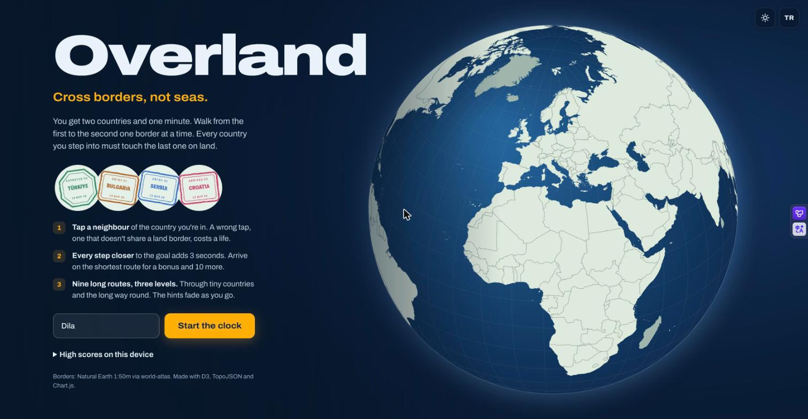
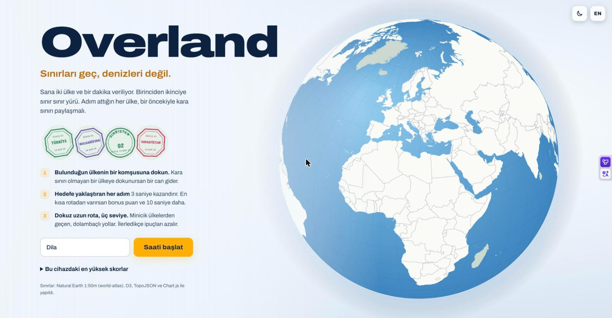
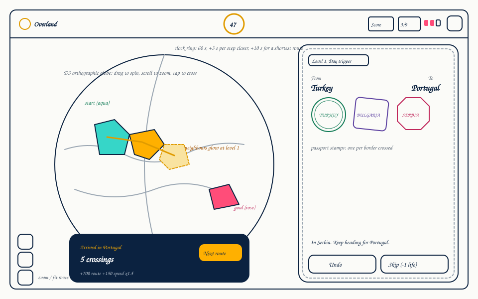
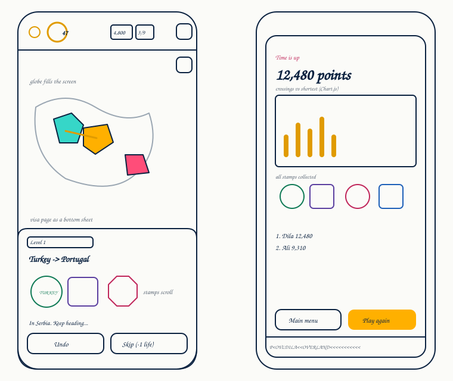
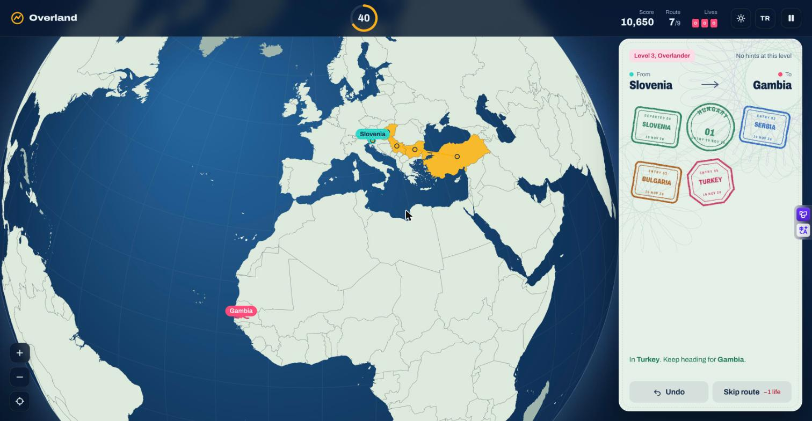
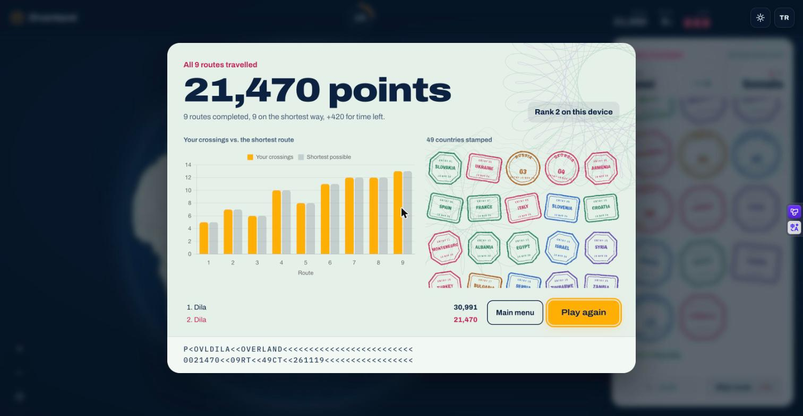
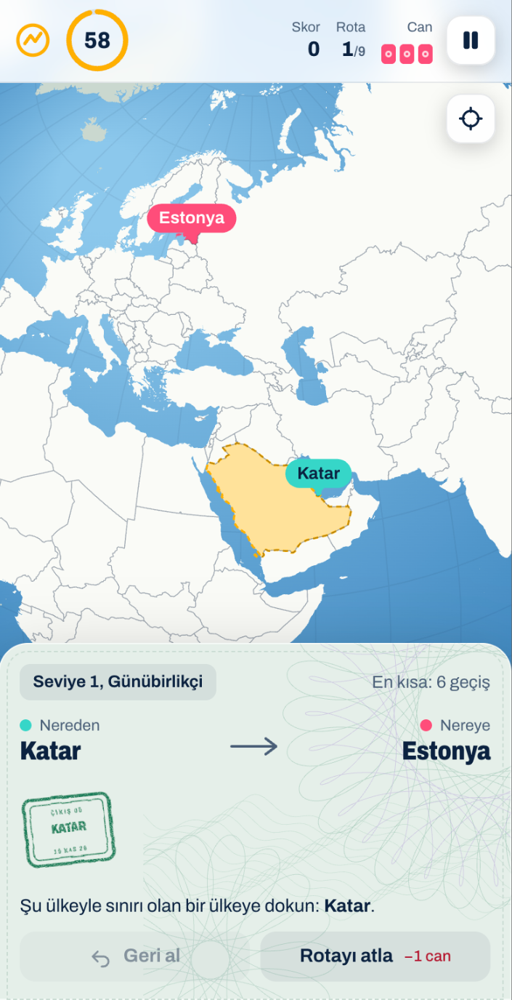

# Overland: cross borders, not seas

**GMT 458 Web GIS, Assignment 2 (GeoGame)**

> **Play it:** https://dilamakar.github.io/overland/
>
> Repository: https://github.com/dilamakar/overland

Overland gives you two countries and one minute. Get from the first to the second by
**crossing land borders only**: every country you step into must share a land border with
the one you're standing in. Tap the countries on a 3D globe and each crossing is inked into
your passport as an entry stamp.

The routes are long on purpose. They are picked from the hardest pairs on Earth: Lesotho to
Liechtenstein, Equatorial Guinea to Andorra, Timor-Leste to Albania. Some run up to 18 border
crossings through tiny countries and around inland seas.

The game has a **night and day theme** and is fully playable in **English and Turkish**,
including all 241 country names.

| Night, English | Day, Turkish |
|---|---|
|  |  |

---

## 1. Game description and functional requirements

| # | Requirement | How Overland meets it |
|---|-------------|-----------------------|
| FR1 | Load an open geographic dataset | Natural Earth 1:50m admin-0 countries (TopoJSON, 241 countries) from `data/`. |
| FR2 | Work out which countries touch on land | `topojson.neighbors()` finds countries whose polygons share an arc. Overseas links you can't walk (France–Brazil via French Guiana) are removed, as are specks too small to tap (Vatican, Monaco). |
| FR3 | Generate hard, solvable puzzles | All-pairs breadth-first search over the border graph, then a difficulty score (length, small countries, detour, number of shortest routes) picks among the hardest pairs (see §3). |
| FR4 | Let the player explore the world | D3 orthographic globe: drag to spin, wheel/pinch or buttons to zoom up to 30×, arrow keys too. |
| FR5 | Select countries by tapping the map | Screen point → `projection.invert` → `d3.geoContains` hit test with a bounding-box pre-filter. Tiny countries get a ring marker so they can be found. |
| FR6 | Validate every move spatially | A move is accepted only if the tapped country borders the last one in the chain. |
| FR7 | Temporal component | 60-second clock; +3 s for every step that gets closer; +10 s for a shortest route; speed bonus; time-left bonus (§7). |
| FR8 | Lives | 3 lives; a wrong tap or a skipped route costs one. |
| FR9 | Difficulty progression | 9 routes in 3 levels; routes get longer and the hints disappear. |
| FR10 | Scoring and high scores | Points per route; top-10 table in `localStorage`. |
| FR11 | Feedback and learning | Distance-to-goal hints at levels 1–2. If you miss the shortest route, it is drawn on the globe afterwards. The end screen compares your crossings with the shortest per route (Chart.js). |
| FR12 | Themes and languages | Night/day theme and English/Turkish, both switchable at any time and remembered. |
| FR13 | Mobile and desktop | Side panel on desktop, bottom sheet on phones; touch, mouse and keyboard all work; auto-pause when the tab is hidden. |

## 2. Frontend layout (sketches)

Desktop: the globe fills the screen. The HUD has the clock ring, score, route counter, lives,
and the theme and language buttons. The "visa page" on the right holds the current route and
your stamps. The arrival card appears after each route.



Mobile: the visa page becomes a bottom sheet with a sideways-scrolling row of stamps. The
game-over screen is a passport page with the chart, every stamp collected and the
high-score table.



The finished screens:

| A level 3 route in progress (night) | Game over: your passport | Phone (day, Turkish) |
|---|---|---|
|  |  |  |

## 3. How the game progresses

| Level | Routes | Shortest route length | Hints | Points ×  |
|-------|--------|----------------------|-------|-----------|
| 1, Day tripper | 1–3 | 5–7 crossings | Countries you can step into next are highlighted; names on hover; "at least N crossings to go" after every step; the shortest length is shown | ×1 |
| 2, Backpacker | 4–6 | 8–11 crossings | No highlights; names on hover; distance hints and shortest length still shown | ×1.5 |
| 3, Overlander | 7–9 | 12–18 crossings | No highlights, no names on hover, no distance hints. Only the start and goal are labelled. | ×2 |

**How routes are chosen.** When the map loads, a breadth-first search from every country
records the number of crossings to every other country and how many different shortest
routes exist. For each route, every pair in the level's length band is a candidate. Each
candidate gets a difficulty score:

```
difficulty = 3   × crossings
           + 2.5 × smallness of start and goal      (tiny countries are hard to find)
           + 1.2 × smallness of countries on the way
           + 5   × (walked distance / straight-line distance − 1)   (winding routes)
           + 4 if there is only one shortest route (+2 if there are at most three)
           − 3   × countries already crossed earlier in this game  (variety)
```

`smallness` is 4 for countries under 1,000 km² (Andorra, Liechtenstein, San Marino),
3 under 12,000 km² (Luxembourg, Gambia, Qatar), 2 under 35,000 km², 1 under 110,000 km².
One route is drawn at random from the top 8% of candidates. Start and goal countries are
never reused within a game.

The game ends when **the clock reaches 0**, **all lives are gone**, or **all 9 routes are done**.

## 4. Number of questions / tasks

**9 routes per game**, 3 per level, generated fresh every time you press *Start the clock*.

## 5. Lives

**3 lives**, drawn as small passports in the HUD. You lose one when you:

- tap a country that doesn't share a land border with the one you're in, or
- press *Skip route* (the shortest route is then shown so you learn it).

Tapping the sea costs nothing. Tapping a country already in your chain takes you back to it,
which is free but costs time.

## 6. Scoring and high scores

For every finished route:

```
route  = 100 × shortest length + 300            if you matched the shortest route
         100 × shortest length − 60 × extra      otherwise (at least 40 × shortest length)
speed  = 300 − 4 × seconds taken (never below 0)
points = (route + speed) × level multiplier (×1, ×1.5, ×2)
```

- **Finish bonus:** if you complete all 9 routes, each second left on the clock is worth 30 points.
- **High scores:** the top 10 (name, score, routes, date) are stored in the browser's
  `localStorage`. The end screen shows your rank and a *New high score* badge. Storage access
  is wrapped in `try/catch`, so the game still runs in private browsing.

## 7. The temporal component

- **One shared minute to start.** The 60-second clock (the amber ring) runs while you are
  choosing countries. It stops on the arrival card and while paused.
- **Progress buys time.** Every crossing that brings you closer to the goal adds 3 seconds.
  Each country pays out only once per route, so walking back and forth earns nothing.
  Arriving on the shortest route adds another 10 seconds. Good navigators can keep going far
  past one minute; guessing drains the clock.
- **Speed bonus** on every route (−4 points per second).
- **Pressure at the end.** In the last 10 seconds the ring and number turn red.
- **Leftover time turns into points** when all 9 routes are done.

## 8. JavaScript libraries

| Library | Version | Used for |
|---------|---------|----------|
| [D3.js](https://d3js.org/) | 7.9.0 | The whole map: `d3.geoOrthographic`, `d3.geoPath` canvas rendering, `geoContains` hit-testing, `geoCentroid`, `geoArea`, `geoBounds`, `geoDistance` (detour measure), `geoGraticule`, `d3.shuffle`, and `d3.timer` + easing for the fly-to camera |
| [TopoJSON client](https://github.com/topojson/topojson-client) | 3.1.0 | Decoding the TopoJSON, land neighbours from shared arcs (`topojson.neighbors`), internal border mesh (`topojson.mesh`) |
| [Chart.js](https://www.chartjs.org/) | 4.4.1 | End-of-game chart: your crossings vs. the shortest possible, per route |

Leaflet/OpenLayers are not used: a tile map can't show a rotating globe, and drawing the
countries ourselves lets every country be coloured by game state. There is no build step, so
the repository can be served directly by GitHub Pages.

## 9. Open datasets

| Dataset | Source | Use |
|---------|--------|-----|
| Admin-0 countries, 1:50m | [Natural Earth](https://www.naturalearthdata.com/) (public domain), TopoJSON packaging by [world-atlas](https://github.com/topojson/world-atlas) 2.0.2 (ISC) | Country shapes, English names and the land-border topology (`data/countries-50m.json`). |
| Turkish country names | Unicode CLDR region names (via `Intl.DisplayNames`, ISO 3166 codes from i18n-iso-countries), with a few hand fixes | `data/names-tr.json`, generated once and stored in the repo. |

A border counts if the two countries share any land border, including exclaves (Poland and
Russia meet at Kaliningrad).

## 10. Implementation notes

### Project structure

```
index.html            page structure: HUD, globe canvas, visa page, arrival card, screens
css/style.css         styling, night/day themes, mobile layout
assets/guilloche.svg  passport security pattern (generated rosette curves)
js/main.js            connects everything: DOM, game flow, events, chart, theme and language
js/game.js            rules, written as closures: clock, score keeper, lives, chain, leaderboard
js/data.js            countries, border graph, all-pairs BFS, difficulty score, route picker
js/globe.js           the D3 canvas globe: rendering, picking, drag/zoom, fly-to
js/stamps.js          passport stamps as inline SVG (shape, ink and tilt come from the name)
js/i18n.js            English and Turkish text, t() lookup, country names per language
data/                 Natural Earth countries (TopoJSON) and Turkish names
docs/                 sketches and screenshots for this README
```

### Three event handlers

1. **Picking a country: `pointerdown` / `pointermove` / `pointerup` on the globe canvas**
   (`js/globe.js`). These tell a tap from a drag (less than 6 px of movement), rotate the
   globe while dragging, handle two-finger pinch zoom, and on a tap turn the screen point into
   longitude/latitude and find the country there. `handlePick()` in `main.js` then checks the
   border, and adds a stamp (plus time if the step gets closer), takes a life, steps back, or
   finishes the route.
2. **Buttons and forms: `submit` / `click`** (`js/main.js`). The start form starts a game; *Undo*,
   *Skip route*, *Next route*, *Pause/Resume*, zoom, *fit route*, and the **theme** and
   **language** buttons each have a click handler. The theme handler flips `data-theme` on
   `<html>` and tells the globe to re-read its colours. The language handler re-renders every
   text, including the stamps.
3. **Keyboard: `document.addEventListener('keydown', …)`** (`js/main.js`). Arrow keys spin the
   globe, `+`/`-` zoom, `U` or Backspace undoes, `Enter` moves on after a route, and `P`/`Esc`
   pause. Keys typed into the name field are ignored.

There is also a `wheel` handler for zoom, a `visibilitychange` handler that pauses the game
when the tab or phone screen is hidden, and a `ResizeObserver` that keeps the globe centred
in the space the panels leave free.

### Closures

- **`createClock(seconds, { onTick, onExpire })`** keeps `remaining`, `running`, the last
  timestamp and the animation-frame id private. `start()`, `stop()` and `add(sec)` are the only
  way to change the time; the callbacks are captured and called every frame.
- **`createChain(start, target)`** owns the list of countries for the current route. `step()`
  decides whether a tap is a valid crossing, the goal, a backtrack or a mistake. Nothing else
  can edit the list.
- **`createScoreKeeper()`**, **`createLives()`** and **`createLeaderboard()`** each remember
  their own total, history, life count or `localStorage` rows.
- **`createGlobe(canvas, world, { onPick, nameOf })`** is one large closure. The projection,
  rotation, zoom, colours, highlight state, pointer tracking and animation timer all live
  inside it, and `main.js` only sees `set()`, `flyTo()`, `flash()`, `zoomBy()`, `nudge()` and
  `refreshColors()`. The `nameOf` function passed in is a closure over the current language,
  so canvas labels switch language without the globe knowing about i18n.
- **`buildIndex(world)`** adds `world.hops(a, b)` and `world.ways(a, b)`: two small functions
  that close over the private all-pairs lookup table.

### Interacting with the DOM

- **Lookups once.** Elements are found once with `getElementById` and kept in an `el` object.
- **Translation through attributes.** Static text carries `data-i18n`, `data-i18n-html`,
  `data-i18n-placeholder`, `data-i18n-aria-label` and `data-i18n-data-empty` attributes, which
  `applyStatic()` fills in. Empty-state messages are drawn by CSS
  `content: attr(data-empty)`.
- **Theme through an attribute.** `data-theme="night|day"` on `<html>` switches a set of CSS
  custom properties. A tiny inline script applies the saved theme before first paint, so the
  page never flashes the wrong theme.
- **Built elements.** Lives, leaderboard rows and the arrival breakdown are created with
  `createElement` and swapped in with `replaceChildren`. Stamps are inline SVG strings,
  uppercased with the right locale (`toLocaleUpperCase('tr')`, so *İ* is correct).
- **State through classes.** `hidden`, `data-mode` on `<body>` (menu/play/paused/over),
  classes such as `is-low`, `is-bonus`, `is-hit`, `is-error` and `is-new`, and CSS variables
  (`--r` for stamp tilt) drive styling and animation. The clock ring's `stroke-dashoffset` is
  set every frame.
- **Canvas.** The globe is drawn on a `<canvas>` sized for the device pixel ratio. Chart.js
  draws the chart on another canvas.

## 11. Running it locally

ES modules must be served over HTTP; opening the file directly from disk won't work.

```bash
python3 -m http.server 8000
# open http://localhost:8000
```

Publishing on GitHub Pages: *Settings → Pages → Deploy from a branch → `main` / root*.

## 12. What I learned from AI

**Conversation:** https://chatgpt.com/s/cx_6afee2712c348191979c8ab4373e68cf (ChatGPT, in Turkish)

I used ChatGPT to think through the two hardest design questions before writing the
game logic: how to get country neighbours out of a map, and how to make routes hard
without making them unfair.

**1. Neighbours come from the topology, not from geometry tests.**
I first assumed I would have to intersect every pair of country polygons. ChatGPT pointed
me to `topojson.neighbors()`: in TopoJSON, two countries that share a border literally share
the same arc, so the neighbour list is a by-product of the data structure. This is a nice
example of why topology matters in GIS: shared boundaries are stored once, so adjacency is
free. It also explained the limits. `neighbors()` doesn't know how long a border is,
generalisation at 1:50m can drop very short borders, and microstates and disputed areas
depend on how the data source defines them.

**2. Overseas territories are a rule decision, not a bug.**
French Guiana is part of France in Natural Earth, so France appears to border Brazil and
Suriname. The advice was to choose a rule on purpose and write it down: either only direct
land borders between the main bodies of states count, or overseas territories count too.
I chose the first rule for a game called *Overland*, removed the France–Brazil and
France–Suriname links, and documented this (and the Kaliningrad exclave case) in §9.

**3. Countries are a graph, and the shortest route is a breadth-first search.**
With countries as nodes and land borders as edges, every crossing costs the same, so BFS
gives the route with the fewest crossings. ChatGPT also suggested precomputing the graph so
it runs instantly in the browser. I went one step further and run BFS from every country
at start-up, which also counts how many different shortest routes exist.

**4. "Shortest" and "hardest" are not the same thing.**
This was the most useful idea. BFS tells you how long a route has to be; difficulty is
about how hard it is for a person to find. The criteria suggested were: route length, how
few alternative shortest routes there are, how small or unfamiliar the countries are, and
how many choices the player faces at each step. Each one is scaled and combined into a
weighted score, with the weights tuned by playing. My score in §3 uses length, smallness
of the endpoints and of the countries on the way, and the number of shortest routes. I
added a detour factor (walked distance divided by straight-line distance) because
winding routes felt hardest when I tested them.

**Other AI use.** The code, styling and this README were written together with Claude Code
(Anthropic's coding assistant). Commits it helped with are marked `Co-Authored-By: Claude`
in the Git history.

## 13. Credits

Country boundaries: Natural Earth (public domain), via world-atlas by Mike Bostock (ISC).
Turkish names: Unicode CLDR. Fonts: Archivo and IBM Plex Mono (Google Fonts, OFL).
